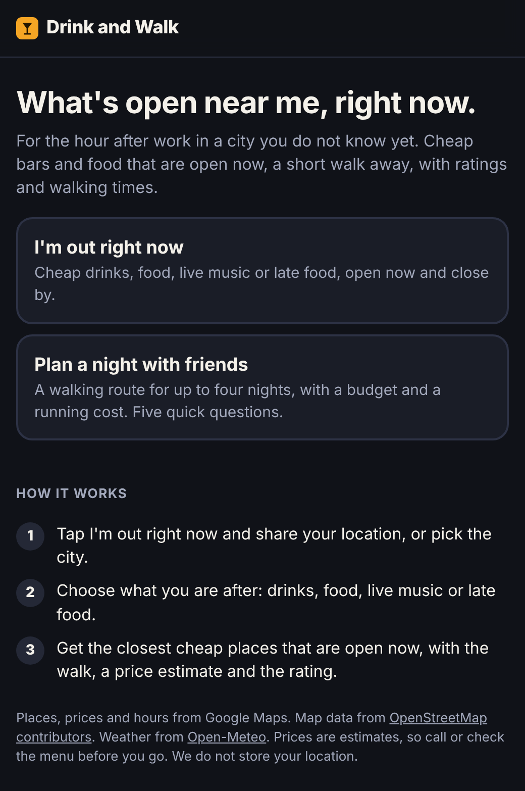

# Drink and Walk

**Live:** https://drink-and-walk.onrender.com (free hosting, so the first visit can take a minute to wake up)



What's open near me, right now? Drink and Walk shows the closest cheap bars and food that are open
now, with the walk, a price estimate and the rating, in local money wherever you are. For nights
with friends, it also plans a walking route with a budget and a running cost.

No accounts and no database. It runs on free OpenStreetMap data out of the box, and a Google Places
key (free monthly allowance) adds real prices, opening hours and ratings.

## Why I built this

I travel the world and work remotely on US hours. Wherever I am, the workday ends late at night,
and that is the only window I have to get out, blow off some steam and grab a drink.

The cities are new to me, so the question is always the same: what is open near me right now that
I would actually like? Google Maps can answer it, but only after a lot of searching, filtering and
opening one place after another. AI chat tools answer fast, but bury the answer in things I did
not ask for.

With an hour before bed, I want three or four places close by, each with the walking distance, the
rating and review count, and a good reason to think I will enjoy it. That is what **I'm out right
now** does. The vibes are dive and chill because those are the bars I like. The trip planner grew
out of the same idea, for nights when friends come along and someone has to plan the route.

## What it does

### I'm out right now

- **Open now, close by.** Cheap places within a short walk that are open for at least the next half
  hour, closest and best value first. Places whose hours can't be read say "Hours unconfirmed".
- **Pick what you're after.** Cheap drinks, cheap food, live music, free-ish, or late food that is
  confirmed open late tonight.
- **A snapshot per place.** Walking time, a price estimate in local money, rating and review count,
  patio and live music tags, plus **Map** and **Check Reddit** links.
- **Cheap by design.** Cocktail lounges, rooftop, wine and hotel bars are left out, and so are places
  rated under 3.5 stars.

### Plan a night with friends

- **Step-by-step flow.** One question per screen: city, dates (up to four nights), group and budget,
  starting point, mood.
- **Starts from where you sleep.** Hotel or address search, neighborhoods, train and bus stations,
  your location, or the city center. Every walk is measured from there.
- **Vibe dials.** Dive, chill or lively, plus live music, late-night food and free-stuff-only toggles.
- **Walking order.** Each stop is close to the one before, and the last round lands on the way home.
- **Swap this stop.** Up to ten cheap options per stop, never repeated within a night. Undo is one tap.
- **Budget meter.** Picks stay inside your limit where they can. If the night still runs over, the
  last round is dropped first and the app says so.
- **Heads-up banners.** US holidays and long weekends, weekend pricing, rain, cold and heat.
- **Copy as text, add to calendar (.ics), share link.**
- **Deal board.** Visitors can add deals the map cannot know, like "$3 pints Tuesday".
  Deals show their age, can be reported as gone, and expire after six months.

## Where the data comes from

| Need | Source | Cost |
| --- | --- | --- |
| City search | Open-Meteo geocoding | Free, no key |
| Bars, pubs, food, hours | Google Places API (New), when a key is set | Free monthly allowance, then paid |
| Bars, pubs, food, hours (fallback) | OpenStreetMap via Overpass API | Free, no key |
| Hotel or address search | Nominatim (OpenStreetMap) | Free, 1 request a second |
| Weather | Open-Meteo forecast (about 16 days) | Free, no key |
| Weather (backup) | MET Norway forecast (about 9 days) | Free, no key |
| Concerts and festivals | Ticketmaster Discovery | Free key, optional |
| Deals | Visitors, stored in `data/deals.json` | Free |

What the app does not know, it says so. OpenStreetMap has no prices and almost no happy hour data,
so prices are estimates and happy hours are only shown when the map actually lists one. Opening
hours are read when they are in a common format. Otherwise the stop says "Hours unconfirmed".
Late-night food is only suggested when hours confirm it is open.

Being kind to free services: map queries are snapped to a grid and cached for a week, counted
against a daily budget shared by all visitors (`DW_OVERPASS_DAILY_LIMIT`, default 80), sent with a
User-Agent, retried on a backup server, and served from older cache if every server is down.

## Run it

```bash
python -m venv .venv && source .venv/bin/activate
pip install -r requirements-dev.txt
python app.py                  # http://127.0.0.1:5000
python -m pytest -q            # tests, no internet needed
```

Optional environment variables:

- `GOOGLE_PLACES_KEY` switches places to Google Places API (New): real price levels and spend
  ranges, real opening hours, live music flags and ratings. Without it the app uses OpenStreetMap,
  and it falls back to OpenStreetMap whenever Google fails. `DW_GOOGLE_DAILY_LIMIT` (default 30)
  caps calls a day; also set a matching daily quota in Google Cloud so nothing can run up a bill.
- `TICKETMASTER_KEY` turns on the "Also on tonight" list (free key at developer.ticketmaster.com).
- `DW_CONTACT` is the URL put in the User-Agent. Set it to your own repo or site.
- `DW_OVERPASS_DAILY_LIMIT` caps live map queries per day.

## Deploy free on Render

Easiest: in Render, New, then **Blueprint**, and pick this repo. `render.yaml` sets up a free web
service with a health check on `/healthz`.

By hand instead: New, then **Web Service**, pick this repo, and use

- Build command: `pip install -r requirements.txt`
- Start command: `gunicorn app:app`
- Instance type: Free. It sleeps when idle and takes about a minute to wake.

`gunicorn.conf.py` is picked up automatically. It runs one worker with eight threads (the rate
limits and caches live in memory, so they need one process) and a 120 second timeout, because a
plan can wait on the main map server and then the backup. Python is pinned in `.python-version`.

The deal board and map cache live on local disk. On free hosting that disk resets when the app
restarts, so deals and cache can disappear. Fine for a demo. For real use, point `DW_DATA_DIR` at a
persistent disk or swap the JSON file for a small database.

### When the free sources say no

- **Overpass** servers get busy, and some refuse cloud IP ranges. A server that fails is rested for
  three minutes so visitors get a quick answer instead of a long wait, and an answer with a
  "runtime error" remark is treated as a failure, never cached as an empty neighborhood.
- **Open-Meteo** has a daily limit per IP, and free hosts share IPs. Forecasts are cached for three
  hours, and when the forecast can't be reached the plan says so instead of leaving it out quietly.

## Tests

Tests cover the hours parser, price estimates, duplicate merging, the planner (never picks a
pricey place, only open places, honest when the map has no live music), the budget meter, every
export, input checks, rate limiting, and each outside source being down. A voice test fails the
build if any line in the app uses stiff phrases or dashes. Test data in `tests/fixtures` is
synthetic. `tests/ui_harness.py` runs the app on that data to look at the screens offline.

## Credits and limits

Map data is from OpenStreetMap contributors (ODbL). Weather by Open-Meteo. Not affiliated with any
bar. Prices and hours can be wrong, so call ahead. Drink responsibly, and do not drive.

MIT license.
